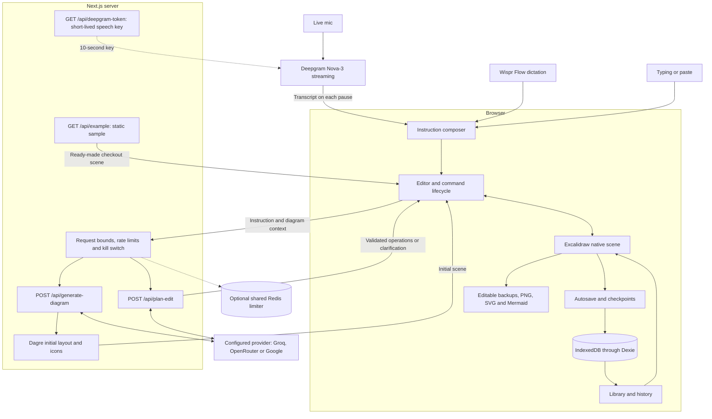
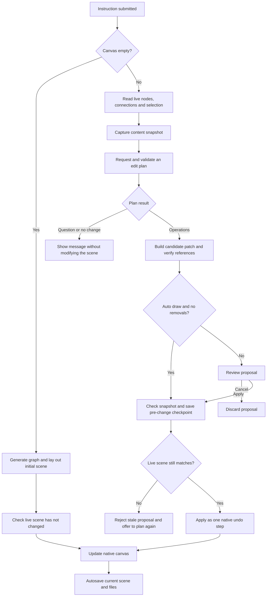

# SaySketch

**Talk your diagrams into shape.**

Turn a spoken explanation into an editable diagram, then refine it without starting over. SaySketch combines natural-language instructions with a drawing canvas for system architecture, process flows and technical documentation.

Tap the mic and talk: the diagram draws on every pause while you keep speaking. Move things by hand, ask for a change, keep the work you already did. Prefer not to speak live? Dictate with Wispr Flow or type instead.

## Try it

Choose **Try the example** on the home page, or open `/d/new?example=1` for a ready-made checkout architecture. Tap the mic and say:

> Add a queue for confirmation emails after the orders service.

The change appears after you pause. Click the canvas and press **Ctrl/Cmd+Z** to undo it. Without a microphone, type the same instruction, review the proposal and select **Apply**.

## Features

- Create architecture diagrams and process flows from a description.
- Add, rename, connect and remove components through instructions.
- Select a component before referring to it as "this" in an instruction.
- Combine conversational edits with native drawing, text, colors and positioning.
- Review changes before applying them, or enable Auto draw for additions and renames.
- Undo and redo edits using canvas history.
- Organize documents in a browser-local library with folders, search and saved checkpoints.
- Import editable backups and export .excalidraw, JSON, PNG and SVG.
- Copy supported graph structure as Mermaid for documentation.

**Layout.** Until you arrange anything by hand, every applied change re-lays out the whole diagram the same way initial creation does, so it stays tidy as it grows. The proposal says when this will happen. Once you move a shape, bend an arrow or draw something, your arrangement is preserved: new components are placed beside related ones and nothing else moves. **Tidy up** in the top bar re-lays out on demand; one Ctrl/Cmd+Z restores your layout. Tidying is skipped for diagrams with groups, frames, or locked or rotated shapes. Ambiguous instructions, unsupported edits and placement failures can require clarification or manual adjustment.

## Talking to SaySketch: the live mic

The live mic is the main way to work. Tap it and keep talking; you never have to stop and wait for the diagram.

- **Draws on every pause.** Speech is transcribed live by Deepgram (Nova-3). A complete sentence is sent as soon as you pause; an unfinished clause ("...connects to") stays buffered until you finish it.
- **Hears tech names.** A built-in vocabulary of common stack names (Spring Boot, RabbitMQ, Kafka, Vercel, GitLab, GraphQL, PostgreSQL, MongoDB, Elasticsearch, AWS, GCP and more) is sent with each session, so they are transcribed correctly.
- **Copes with mishearings.** If a name is still misheard, the planner maps it to the existing component it refers to instead of adding a duplicate, and spells well-known technologies correctly.
- **Never loses speech.** Anything you say while a change is being planned is queued and sent next, once.
- **Safe by default.** Additions and renames apply as you go; deletions still wait for your review.
- **Fast / normal / slow** sets how long a pause must be. Stop waits briefly for the final words before closing the microphone.

The mic appears when the server has Deepgram configured (`DEEPGRAM_ENABLED=1`, `DEEPGRAM_API_KEY`, `DEEPGRAM_PROJECT_ID`); otherwise the editor offers Wispr Flow and typing only.

Follow-up requests include up to six recent accepted instruction fragments, bounded to 6,000 characters, alongside the current graph. This helps resolve references and corrections across chunks. Current scene content remains authoritative after manual edits or undo. Initial creation and incremental edits represent hosting through provider nodes and labelled connections unless a grouping boundary is explicitly requested.

The speech-token endpoint uses shared rate limiting when configured and fails closed if that limiter is unavailable. Without shared configuration it retains local-process limits, so public access still requires deployment-level protection and provider spend controls.

## Other ways to give instructions: Wispr Flow or typing

The instruction box under the mic accepts Wispr Flow dictation, typing and paste.

1. Open a diagram and press **Ctrl/Cmd+K** to focus the instruction box.
2. Activate your configured Wispr Flow shortcut and dictate.
3. In review mode, press **Enter**, inspect the proposal and select **Apply**.

**Auto draw** submits after text stops changing for 1.8 seconds. It draws an initial description and automatically applies validated additions and renames. Deletions still require review. Turn it off when you want to compose without submitting on a pause.

This mode responds to inserted text, including typing and paste. If Flow inserts text when you finish dictating, drawing starts after that insertion. Keep the instruction box focused while speaking. Anything you dictate while a change is still being planned stays in the box and is sent next, once; nothing is re-sent.

**Shift+Enter** inserts a new line. Failed instructions remain available for correction or retry.

## Run locally

Requires Node.js 22 and npm.

```sh
npm ci --ignore-scripts --no-audit --no-fund
```

Copy `.env.example` to `.env.local` and configure your Groq credential:

```dotenv
GROQ_API_KEY=your_key_here
NEXT_PUBLIC_BASE_URL=http://localhost:3000
```

Optionally set `GROQ_MODEL` to a supported model available to your account. Never commit `.env.local` or publish credentials.

```sh
npm run dev
```

Open [localhost:3000](http://localhost:3000). The included `.npmrc` accommodates peer dependency declarations in the canvas dependency tree.

For a production build:

```sh
npm run build
npm start
```

Before public hosting, configure shared request limiting with `UPSTASH_REDIS_REST_URL` and `UPSTASH_REDIS_REST_TOKEN`, verify provider quotas and set your public base URL. Without shared configuration, limiting is per server process. If a configured shared limiter becomes unavailable, requests are blocked rather than silently weakening protection. See `.env.example` for operational switches.

**Live mic setup.** Create a Deepgram project and an API key that can create keys (the server mints 10-second browser keys from it), then set `DEEPGRAM_ENABLED=1`, `DEEPGRAM_API_KEY` and `DEEPGRAM_PROJECT_ID`. The speech-token route is rate limited like the AI routes; on a public deployment also use shared limiting or access protection, because each session spends Deepgram credit. Wispr Flow and typing work without Deepgram.

## Saving and backups

Documents are stored in this browser using IndexedDB. They do not automatically synchronize across devices. Wait for **Saved** before refreshing or closing, and export important documents as editable backups.

JSON and .excalidraw backups include embedded image data. PNG and SVG are visual exports. Mermaid represents supported nodes and connections; it cannot preserve every annotation, image or canvas style.

Use one editing tab per document. Concurrent editing across tabs is not supported. History previews are read-only; return to the current scene before issuing instructions.

Instructions and relevant diagram context are sent to the configured external provider. This is not an entirely offline application. Personal credentials entered in Settings are kept in session storage for the current tab.

## Checks

```sh
npm run typecheck
npm run lint
npm test
npx playwright install chromium
npm run test:e2e
```

Browser tests use controlled service responses. Verify actual Wispr dictation, provider behavior and the deployed experience separately before publishing or recording the final demo.

## Architecture

The browser owns the editable scene and local documents. Next.js routes handle generation and edit planning; the canvas remains the source of truth for subsequent changes.



The browser streams microphone audio directly to Deepgram using a 10-second key minted by the server, so the long-lived Deepgram key never reaches the browser. Wispr Flow inserts text into the composer through its desktop app. Documents and embedded files stay in browser storage; submitted instructions and diagram context travel to the configured provider through the server.

### How an instruction becomes an edit

Initial creation uses automatic layout. Later instructions operate on the current scene through bounded patches, tidied with the same layout until the user arranges something by hand.



Validation and request failures leave the current scene intact. Edits are checked again after checkpoint saving, and ordinary patches preserve the viewport and unrelated elements. Native undo handles the in-session edit history; saved checkpoints provide a separate durable recovery path.

## Built with

Next.js, React, TypeScript, Excalidraw, Dagre and Dexie. Regression checks use Vitest and Playwright.

## License

MIT.
